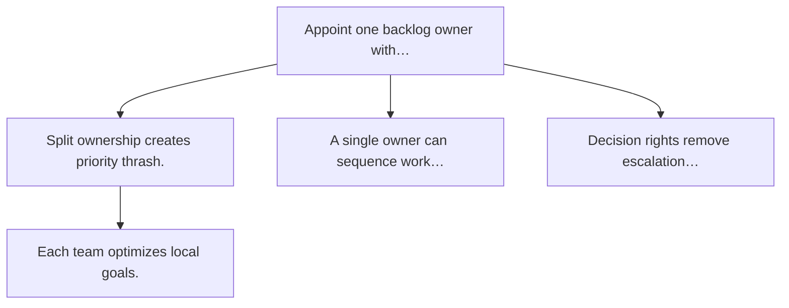

# Example: analyze → pyramid + ArgumentTree

Required reply shape for `/make-the-point`. Diagram first (short labels). JSON second (full claims and support figures).

## Pyramid diagram



## ArgumentTree JSON

```json
{
  "version": 1,
  "mode": "analyze",
  "source": {
    "kind": "text",
    "excerpt": "Memo arguing for a single backlog owner"
  },
  "scqa": {
    "situation": "Two teams share one product backlog.",
    "complication": "Priorities conflict and delivery slips.",
    "question": "How should we set priority?",
    "answer": "Appoint one backlog owner with explicit decision rights."
  },
  "governingThought": "Appoint one backlog owner with explicit decision rights.",
  "horizontalLogic": "inductive",
  "keyLine": [
    {
      "id": "K1",
      "claim": "Split ownership creates priority thrash.",
      "role": "reason",
      "children": [
        {
          "id": "K1.1",
          "claim": "Each team optimizes local goals.",
          "role": "reason",
          "support": ["Sprint goals diverged three times last quarter."]
        }
      ]
    },
    {
      "id": "K2",
      "claim": "A single owner can sequence work against one outcome.",
      "role": "reason",
      "support": ["Peer products that use one owner ship on a shared roadmap."]
    },
    {
      "id": "K3",
      "claim": "Decision rights remove escalation latency.",
      "role": "reason",
      "support": ["Escalations currently take a median of five days."]
    }
  ],
  "prose": "Appoint one backlog owner with explicit decision rights. Split ownership creates priority thrash because each team optimizes local goals. A single owner can sequence work against one outcome. Decision rights remove escalation latency.",
  "notes": ["Source did not quantify thrash cost beyond escalation latency."]
}
```
